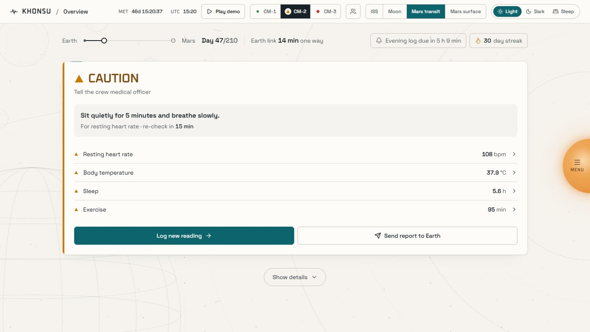
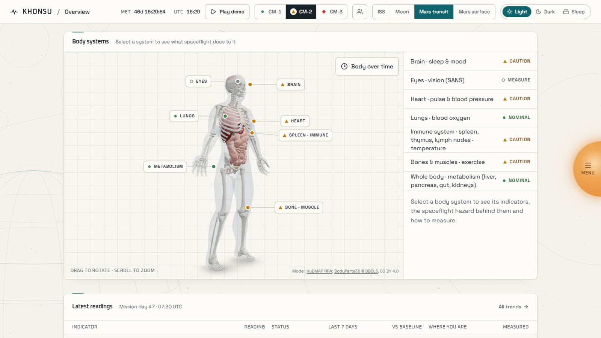
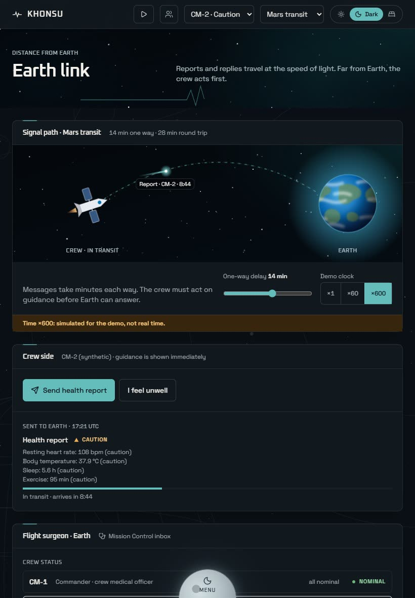
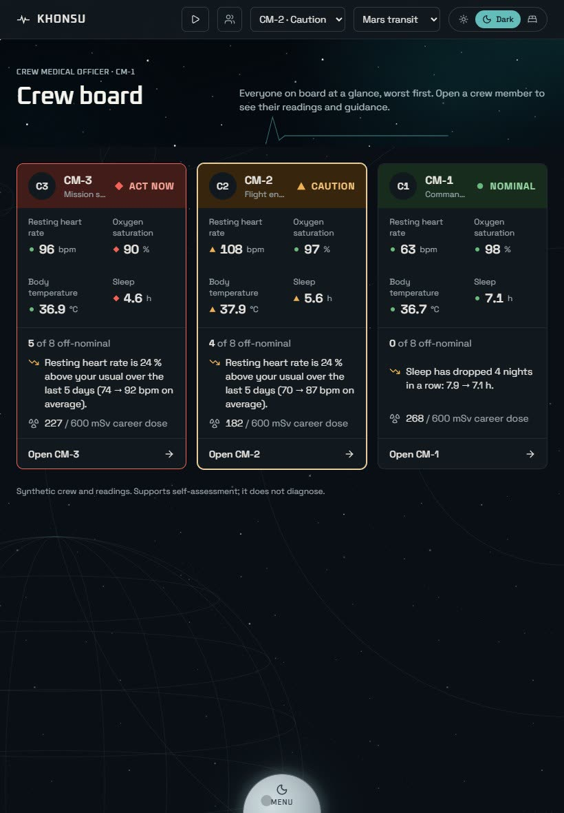
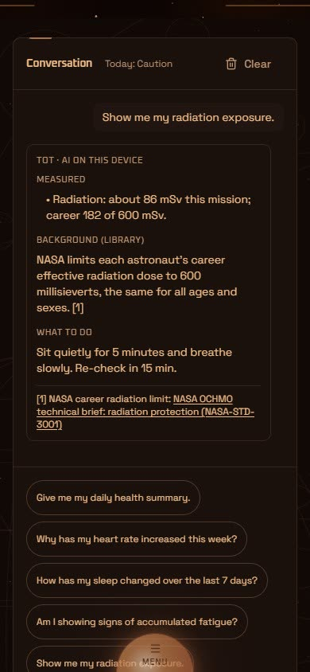
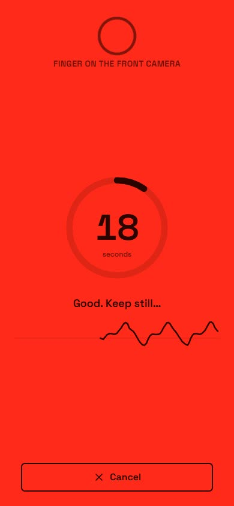
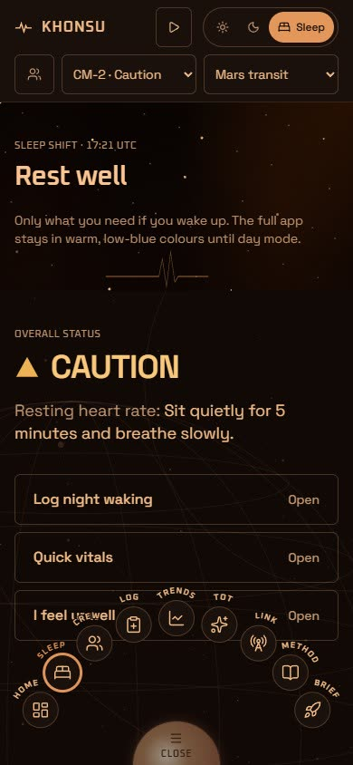

# Khonsu — Astronaut Health Monitor

> NASA Space Apps Challenge 2026 · Challenge: *Create Health Monitoring Software for Astronauts on Space Missions* · Team **A-team**

**Live app:** https://simeonpetr0v.github.io/NASA-Space-App-Challenge-A-Team/ · **Demo video (30 s):** on the Space Apps project page · **Team:** A-team

On the way to Mars, the nearest doctor is up to 20 light-minutes away. Khonsu is a visual self-check for astronauts: they log a few health readings, the app compares them with safe ranges **and** with their own personal baseline, shows the result at a glance and says the one thing to do now — and when to tell the crew medical officer or the flight surgeons on Earth. **It supports self-assessment; it does not diagnose.** All crew data in the demo is synthetic.

*Khonsu* is the Egyptian moon god who watched over night travellers; *TOT* (after Thoth, god of wisdom and writing) is the app's on-device AI assistant.

## Screenshots

| Laptop · Light theme | |
|---|---|
|  |  |

| Tablet · Dark theme | | Phone · Sleep theme | | |
|---|---|---|---|---|
|  |  |  |  |  |

## What it does
- **Quick check (Overview):** overall status, the single next action, and only the off-nominal readings. *Show details* opens everything else.
- **8 indicators:** resting heart rate, blood pressure, oxygen saturation, body temperature, fasting blood glucose, sleep, mood (WHO-5 check-in) and exercise; plus a **radiation budget** against NASA's 600 mSv career limit.
- **Status you can read three ways:** colour **+** shape **+** word (● Nominal, ▲ Caution, ◆ Act now), so it works for colour-blind users and in low light.
- **Guidance for every non-normal value:** do now · re-check in · escalate if — written in plain words, each threshold with its source.
- **Escalation:** self-care → tell the crew medical officer → flight surgeon on Earth.
- **Trend watch:** catches slow changes against the personal baseline (e.g. resting heart rate 24 % above usual for 5 days) before a limit is crossed.
- **Interactive 3D body** with bones and organs; select a system to see its readings and the spaceflight hazard behind them; *Body over time* slider. Works with mouse, touch and keyboard.
- **Log reading** in seconds, including **camera pulse** (fingertip on the phone or laptop camera, live pulse trace; an estimate, not a medical device).
- **Ask TOT:** an AI assistant that runs **on the device and offline** (WebLLM / WebGPU; a smaller processor model on phones without WebGPU). Khonsu supplies all numbers; TOT explains and cites its sources.
- **Earth link:** reports and replies travel with the real light delay (Mars transit: 14 min one way); a demo clock (×60, ×600) shows the flight surgeon's reply.
- **Crew board** for the crew medical officer: everyone at once, worst first.
- **Light, Dark and Sleep themes** (warm, low-blue colours for the sleep shift), mission modes (ISS, Moon, Mars transit, Mars surface), installable PWA that works offline.
- **Play demo** (top bar) runs the whole story by itself with captions.

## How it works
1. **Input** — manual entry with safe entry envelopes, the camera pulse, or the well-being check-in.
2. **Assessment** — each reading is compared with an absolute range (sourced) **and** with the astronaut's own baseline (last days' average); combined findings (e.g. raised temperature + raised heart rate) raise the level.
3. **Status** — nominal / caution / act now, per indicator and overall.
4. **Guidance** — do now · re-check in · escalate if, from the data file `app/src/data/indicators.ts` (every threshold has a `sourceUrl`).
5. **Escalation** — self-care, crew medical officer, or flight surgeon; reports go to Earth with the real light delay.

The **Methodology** page answers NASA's five challenge questions from the app's own data and lists every source. The **Mission brief** explains the five spaceflight hazards (RIDGE).

## NASA data and resources
| NASA resource | How Khonsu uses it |
|---|---|
| [HRP — 5 Hazards of Human Spaceflight (RIDGE)](https://www.nasa.gov/hrp/hazards/) | Every body system and indicator is mapped to a hazard; shown in the 3D body details and the Mission brief |
| [HRP — Risks of Human Spaceflight](https://www.nasa.gov/hrp/risks/) | Indicator ↔ risk mapping and the "why it matters" texts |
| [HRP — Risk from Inadequate Sleep and Irregular Schedules](https://www.nasa.gov/reference/risk-from-inadequate-sleep-and-irregular-schedules/) | Sleep thresholds context, fatigue trend, Sleep-shift mode |
| [HRP — Reduced Cardiorespiratory and Musculoskeletal Fitness](https://www.nasa.gov/reference/risk-of-reduced-cardiorespiratory-and-musculoskeletal-fitness/) · [Astronaut Exercise](https://www.nasa.gov/missions/station/iss-research/astronaut-exercise/) | Exercise target and the "exercise dropped" trend |
| NASA OCHMO technical brief — radiation protection (NASA-STD-3001) | 600 mSv career limit in the radiation budget and TOT's library |
| [Heat Safety in Space](https://www.nasa.gov/missions/station/heat-safety-in-space-keeps-infants-and-patients-safe-on-earth/) | Spaceflight thermoregulation context for body temperature |

Full list with licences: [docs/references.md](docs/references.md).

## Run locally
Requires Node 22 (`app/.nvmrc`).

```bash
cd app
npm install
npm run dev
```

Build: `npm run build` · Lint: `npm run lint` · Tests: `node --test tests/readings.test.mjs` (all from `app/`). Every push to `main` deploys to GitHub Pages.

**Stack:** React 19 + Vite + TypeScript, Tailwind CSS v4 + shadcn/ui (Radix), Motion, three.js with React Three Fiber, WebLLM and Transformers.js for TOT, vite-plugin-pwa. No backend: everything stays on the device (localStorage).

## Team — A-team
Six members; names and roles are on the Space Apps project page.

## Use of AI tools
The idea, scope, science choices and design direction are the team's. AI tools helped as follows:
- **Claude Code (Anthropic)** — code assistance for the web app, the 3D body build scripts, tests, documentation drafts, and the demo video edit (recording scripts, composition, subtitles). All changes were reviewed and merged by the team; AI-assisted commits say so in the commit message.
- **TOT, the in-app assistant**, runs open models on the user's device (Llama 3.2 1B, Qwen 2.5 0.5B/1.5B, SmolLM2 360M). Khonsu's own analytics supply every number; the model only explains and cites sources from the app's library. It does not diagnose.
- **Design-review skills** (Impeccable, Emil Kowalski skills, Anthropic frontend-design) were used as AI guidance; they are not shipped in the app.
- **No AI-generated images and no AI voice** are used. The video voice-over is a team member's own voice.

## Licence
Code: [MIT](LICENSE). Third-party assets keep their own licences (3D models CC BY 4.0, fonts SIL OFL 1.1, libraries MIT / Apache-2.0 / ISC) — see [docs/references.md](docs/references.md). No NASA logos or insignia are used.

## References
See [docs/references.md](docs/references.md).
